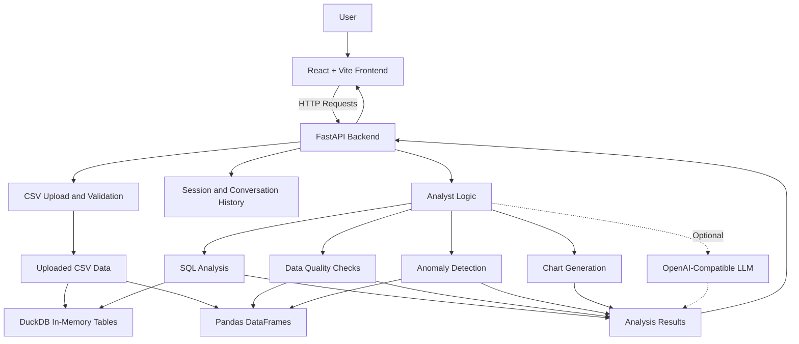

# Lens — AI Data Analyst

An AI-powered data analyst built as part of the **Digital Back Office Ltd. Software Engineer Intern Assignment**. Lens allows users to upload CSV datasets, ask questions in natural language, explore business insights, generate charts, inspect SQL/Pandas code, and investigate data anomalies.

**[Live Application](https://lens-ai-data-analyst.vercel.app/) · [GitHub Repository](https://github.com/nehawawale07/lens-ai-data-analyst) · [Backend API Docs](https://lens-ai-data-analyst.onrender.com/docs)**

---

## Table of Contents

- [Overview](#overview)
- [Key Features](#key-features)
- [Architecture](#architecture)
- [Technology Stack](#technology-stack)
- [Getting Started](#getting-started)
- [Optional LLM Configuration](#optional-llm-configuration)
- [Docker Setup](#docker-setup)
- [Sample Questions](#sample-questions)
- [Testing](#testing)
- [Assignment Requirements](#assignment-requirements)
- [Assumptions and Limitations](#assumptions-and-limitations)
- [Live Demo](#live-demo)

---

## Overview

Lens transforms raw CSV data into understandable business insights through a conversational interface. Users can upload one or more datasets, ask analytical questions, and explore results without manually writing every query.

The application supports both a local analysis mode and optional integration with an OpenAI-compatible language model.

## Key Features

- **CSV Upload and Validation:** Upload datasets for analysis and inspect their structure.
- **Natural Language Q&A:** Ask questions about uploaded data in plain English.
- **Business Insights:** Identify revenue patterns, compare performance, and explore key metrics.
- **Interactive Visualizations:** Generate charts to communicate analytical findings.
- **SQL and Pandas Code:** Inspect the code associated with supported analyses.
- **Anomaly Detection:** Identify unusual data points using statistical methods such as Z-score and IQR.
- **Data Quality Checks:** Investigate potential data quality issues.
- **Conversational Context:** Maintain question history within a session.
- **Optional LLM Integration:** Enable model-assisted analysis using an OpenAI-compatible API.
- **Local Analysis Mode:** Run supported analyses without requiring a paid LLM API key.

---

## Architecture



### How the Architecture Works

1. **Frontend:** React and Vite provide the user interface for chatting with the analyst and viewing analysis results and charts.
2. **API Layer:** FastAPI handles frontend requests, dataset uploads, validation, and session management.
3. **Data Processing:** Uploaded CSV data is processed using pandas and DuckDB.
4. **Analysis:** The analyst logic supports SQL-based analysis, data quality checks, anomaly detection, and chart generation.
5. **Optional LLM:** When configured, an OpenAI-compatible model can assist with analysis and tool selection.
6. **Results:** The backend returns analysis results to the frontend for presentation.

When an LLM API key is not configured, the application uses its local analyst mode for supported analytical questions.

---

## Technology Stack

| Layer | Technologies | Purpose |
|---|---|---|
| Frontend | React, Vite | User interface and conversational workflow |
| Visualisation | Plotly | Interactive charts |
| Backend | Python, FastAPI | API endpoints and application logic |
| Data Analysis | pandas, DuckDB | Data processing and SQL queries |
| AI Integration | OpenAI-compatible LLM (optional) | Model-assisted analysis |
| Testing | pytest | Backend test suite |
| Deployment | Vercel, Render | Frontend and backend hosting |
| Containerisation | Docker, Docker Compose | Container-based local execution |

---

## Getting Started

### Prerequisites

- Python 3.11 or later recommended
- Node.js 20 or later recommended
- Git
- Docker and Docker Compose (optional)

### 1. Clone the Repository

```bash
git clone https://github.com/nehawawale07/lens-ai-data-analyst.git
cd lens-ai-data-analyst
```

### 2. Configure Environment Variables

Create a local environment file from the example:

**Windows Command Prompt:**
```bat
copy .env.example .env
```

**macOS/Linux:**
```bash
cp .env.example .env
```

LLM configuration is optional. The application can run in local mode without an API key.

### 3. Set Up the Python Environment

From the project root, run:

**Windows PowerShell:**
```powershell
python -m venv .venv
.\.venv\Scripts\Activate.ps1
pip install -r backend\requirements.txt
```

**Windows Command Prompt:**
```bat
python -m venv .venv
.venv\Scripts\activate
pip install -r backend\requirements.txt
```

**macOS/Linux:**
```bash
python3 -m venv .venv
source .venv/bin/activate
pip install -r backend/requirements.txt
```

### 4. Start the Backend

From the project root, run:

```bash
python -m uvicorn app.main:app --app-dir backend --reload --port 8000
```

The backend API will be available at:

- API: http://localhost:8000
- API Documentation: http://localhost:8000/docs

### 5. Start the Frontend

Open a second terminal and run:

```bash
cd frontend
npm install
npm run dev
```

Open the local frontend URL printed by Vite, usually:

http://localhost:5173

### 6. Try the Application

Upload `sample_data/sales.csv` and optionally `sample_data/customers.csv`, then ask a question from the [Sample Questions](#sample-questions) section.

---

## Optional LLM Configuration

Lens can use an OpenAI-compatible language model when the appropriate configuration is supplied.

Add the following to your local `.env` file:

```env
OPENAI_API_KEY=your_api_key_here
OPENAI_MODEL=gpt-4o-mini
```

Do not commit real API keys or secrets to version control.

### Ollama Example

For a compatible local Ollama setup, configure:

```env
OPENAI_API_KEY=ollama
OPENAI_BASE_URL=http://localhost:11434/v1
OPENAI_MODEL=llama3.1
```

Ensure that Ollama is running and the selected model is available locally.

**Without an API key, the application remains usable in local analysis mode for supported questions.**

---

## Docker Setup

If Docker and Docker Compose are installed, run the following commands from the project root.

Create the environment file if needed:

```bash
copy .env.example .env
```

Then start the services:

```bash
docker compose up --build
```

The expected local endpoints are:

- Application: http://localhost:8080
- Backend health check: http://localhost:8000/health

To stop the services, run:

```bash
docker compose down
```

---

## Sample Questions

Try asking Lens questions such as:

- Which region generated the highest revenue?
- Show monthly sales trends.
- Create a bar chart comparing revenue by region.
- Show a line chart of sales over time.
- Which products are underperforming?
- What are the top five customers?
- Generate SQL for this analysis.
- Detect anomalies in the dataset.
- Check the dataset for data quality issues.

The sample `sample_data/sales.csv` dataset includes a planted revenue outlier (`ORD-1420`) for demonstrating anomaly detection.

---

## Testing

Run the backend tests from the project root:

```bash
python -m pytest backend/tests -q
```

To create a production build of the frontend:

```bash
cd frontend
npm install
npm run build
```

---

## Assignment Requirements

| Requirement | Implementation |
|---|---|
| Multi-CSV upload and validation | Upload API and CSV processing service |
| Natural-language questions | Chat API and analyst logic |
| Business insights and summaries | Local analysis and optional LLM tools |
| Data visualizations | Plotly charts in the frontend |
| SQL and Pandas code | Analysis response and code panel |
| Anomaly detection and explanations | Z-score and IQR-based analysis |
| Reasoning | Explanation accompanying analysis results |
| Session context | In-memory session history |
| Data quality checks | Data quality analysis tools |
| Docker support | `docker-compose.yml` |
| Automated tests | `backend/tests` |
| Live deployment | Vercel frontend and Render backend |

---

## Assumptions and Limitations

- **Session storage:** Sessions and uploaded datasets are held in memory. Restarting the backend clears in-memory state.
- **SQL execution:** SQL analysis is intended to be read-only and operates on DuckDB tables derived from uploaded files.
- **Optional LLM:** An LLM API key is not required for supported local-mode analyses.
- **Product performance:** “Underperforming products” is interpreted as products with the lowest total revenue.
- **Analysis scope:** Results depend on the uploaded data, supported analysis tools, and the quality of the input datasets.

---

## Live Demo

**Application:** [https://lens-ai-data-analyst.vercel.app/](https://lens-ai-data-analyst.vercel.app/)

**Backend API:** [https://lens-ai-data-analyst.onrender.com](https://lens-ai-data-analyst.onrender.com)

**Interactive API Documentation:** [https://lens-ai-data-analyst.onrender.com/docs](https://lens-ai-data-analyst.onrender.com/docs)

---

<p align="center">
  Built as part of the Digital Back Office Ltd. Software Engineer Intern Assignment.
</p>
