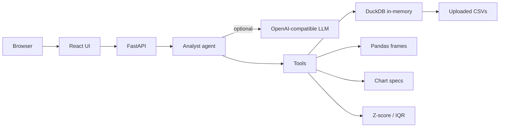

# Lens — AI Data Analyst

Internship assignment for **Digital Back Office Ltd.**: an AI-powered data analyst that accepts one or more CSVs and answers questions in natural language.

Users can upload files, ask business questions, get SQL/pandas, charts, anomaly explanations, and a short reason for each answer. Conversation history is kept for the session.

## Architecture



- **Frontend:** React + Vite. Chat, schema sidebar, Plotly charts, SQL/pandas panel.
- **Backend:** FastAPI. Session store, CSV validation, read-only SQL, anomaly/quality tools.
- **Analyst:** If `OPENAI_API_KEY` is set, the model uses tool calling (`get_schema`, `execute_sql`, `create_chart`, `detect_anomalies`, `data_quality`). Otherwise a local analyst still answers the assignment example questions using the same tools.

## Quick start (local)

Python 3.11+ and Node 20+ recommended.

```bash
copy .env.example .env
python -m venv .venv
.venv\Scripts\activate
pip install -r backend\requirements.txt
cd backend
uvicorn app.main:app --reload --port 8000
```

In another terminal:

```bash
cd frontend
npm install
npm run dev
```

Open http://localhost:5173 and upload `sample_data/sales.csv` (and optionally `sample_data/customers.csv`).

### LLM (optional)

Edit `.env`:

```
OPENAI_API_KEY=sk-...
OPENAI_MODEL=gpt-4o-mini
```

Ollama example:

```
OPENAI_API_KEY=ollama
OPENAI_BASE_URL=http://localhost:11434/v1
OPENAI_MODEL=llama3.1
```

Without a key, the app still runs in **local** mode.

## Docker

```bash
copy .env.example .env
docker compose up --build
```

App: http://localhost:8080  API: http://localhost:8000/health

## Tests

```bash
cd backend
pytest
```

## Sample questions

- Which region generated the highest revenue?
- Show monthly sales trends.
- Which products are underperforming?
- What are the top five customers?
- Generate SQL for this analysis.
- Detect anomalies in the dataset.

`sample_data/sales.csv` includes a planted revenue outlier (`ORD-1420`) so anomaly detection has something to explain.

## Deliverables checklist

| Requirement | Where |
| --- | --- |
| Multi-CSV upload + validation | `/api/upload`, `csv_service.py` |
| Natural language Q&A | `/api/chat` + agent |
| Insights / summaries | local + LLM tools |
| Charts | Plotly in the UI |
| SQL / pandas | returned with each analysis |
| Anomalies + explanation | z-score + IQR |
| Reasoning | “Why this answer” in chat |
| Session context | `session.history` |
| Docker | `docker-compose.yml` |
| Tests | `backend/tests` |

## Assumptions

- Sessions live in memory (restarting the server clears uploads).
- SQL is read-only `SELECT`/`WITH` against DuckDB tables named after the files.
- LLM is optional so the assignment can be demoed without a paid key.
- “Underperforming products” is interpreted as lowest total revenue.

## Demo video

Record 10–30 seconds: upload `sales.csv` → ask for monthly trends → ask for anomalies. Put the file or a hosted link here when you submit:

- Demo: *(add URL)*
- Live app: *(add URL if deployed)*
